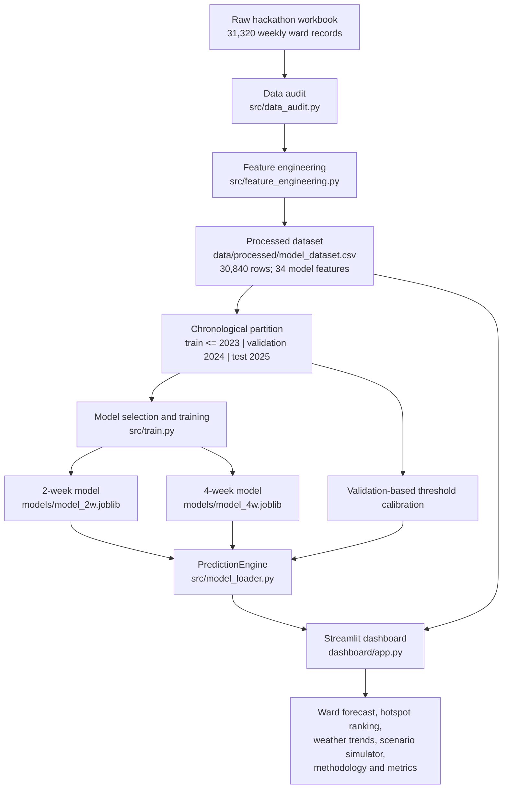

# DenguAlert AI — System Architecture

## 1. System data flow

### Data and feature pipeline

The application starts from `data/hackathon_preli_dataset.xlsx` (sheet `bangladesh_dengue_large_dataset`). The workbook contains 31,320 weekly observations across 60 wards. `src/feature_engineering.py` sorts records by `ward_id` and date, then creates features within each ward so lag calculations do not cross ward boundaries.

Weather features include rainfall lags for weeks 1–4, 2- and 4-week rainfall rolling sums, a log-transformed rainfall value, temperature lags and a 4-week temperature average, humidity lags, and a temperature–humidity interaction. The pipeline also creates historical dengue-case lags, ward vulnerability inputs, and calendar/monsoon features. The model dataset contains 34 predictor features; current-week `dengue_cases`, future targets, target dates, `date`, and `split` are excluded from model inputs.

The two supervised targets are `target_2w` and `target_4w`, created from dengue counts two and four weekly observations ahead within the same ward. Rows without the required past lags or future targets are removed, producing `data/processed/model_dataset.csv` (30,840 rows).

## 2. Chronological validation strategy

Rows are partitioned using the later outcome date, `target_date_4w`, rather than a random split or only the observation date. This prevents a row from being assigned to an earlier partition when its 4-week outcome falls in a later period.

| Partition | Target-date period | Rows | Purpose |
|---|---|---:|---|
| Train | Through 2023 | 24,540 | Fit preprocessing and candidate models |
| Validation | 2024 | 3,180 | Select model configuration and calibrate risk thresholds |
| Test | 2025 | 3,120 | Final, held-out performance evaluation |

The training pipeline in `src/train.py` fits the categorical `OrdinalEncoder` inside a scikit-learn `Pipeline` using training data only. The validation partition is used for model selection; the 2025 test partition is reserved for final reporting and should not be used to tune the model or thresholds.

## 3. Model selection rationale

Dengue case counts are non-negative count outcomes and include many low/zero-count weeks. The project uses separate `HistGradientBoostingRegressor` pipelines for the 2-week and 4-week targets. The training script compares candidate gradient-boosting configurations (including Poisson and squared-error objectives) on the 2024 validation partition and selects the candidate with the lowest validation MAE for each horizon. The documented adopted model is HistGradientBoostingRegressor with Poisson loss, which is suitable for non-negative count prediction.

Each pipeline encodes the categorical `city` and `ward_id` features with `OrdinalEncoder(handle_unknown="use_encoded_value", unknown_value=-1)` and passes numeric features through. The fitted pipelines are serialized as `models/model_2w.joblib` and `models/model_4w.joblib`. Operational risk thresholds are stored in `models/calibrated_config.json` and applied by `src/model_loader.py` to classify predictions as Low, Medium, High, or Critical.

The project reports evaluation on the held-out 2025 test partition (N = 3,120): 2-week MAE 1.0549 and RMSE 2.1256; 4-week MAE 1.1904 and RMSE 2.3158. Reported Critical-tier recall is 72.2% for the 2-week model and 65.1% for the 4-week model. These are retrospective benchmark results on the supplied dataset, not a guarantee of future outbreak detection.

## 4. Inference, caching, and cost controls

`dashboard/app.py` calls the local `PredictionEngine` from `src/model_loader.py`. The engine loads the two serialized Joblib pipelines and threshold configuration from the repository; predictions run locally in the Streamlit process. The dashboard uses `st.cache_resource` for the model engine and `st.cache_data` for the processed surveillance dataset to avoid reloading those resources on every rerun.

The current prototype uses the supplied historical workbook and processed CSV. It does not call a paid weather API, LLM API, or remote prediction service for model inference, and it does not spend LLM tokens. The sidebar displays a static icon hosted on the Flaticon CDN; this is an external static-image request, not a weather or inference API. No API key or secret is required for the current application.

The what-if module is a scenario/sensitivity view over the selected historical record. It should not be described as a live weather forecast. Scenario edits must be interpreted according to the features actually changed by the simulator; the current implementation changes current-week weather inputs and derived current-rainfall log value, but does not rebuild all historical lag columns from a simulated multi-week weather sequence.

## 5. Runtime components

- **Local/deployed interface:** Streamlit (`dashboard/app.py`).
- **Feature generation:** pandas/NumPy (`src/feature_engineering.py`).
- **Model training and preprocessing:** scikit-learn (`src/train.py`).
- **Saved inference artifacts:** Joblib models and JSON thresholds (`models/`).
- **Processed input table:** `data/processed/model_dataset.csv`.
- **Automated checks:** `tests/test_dashboard_integration.py` and the verification scripts under `src/`.

The dashboard is a public-health decision-support prototype. It is not a clinical diagnostic tool and should be interpreted alongside verified local surveillance and public-health expertise.
