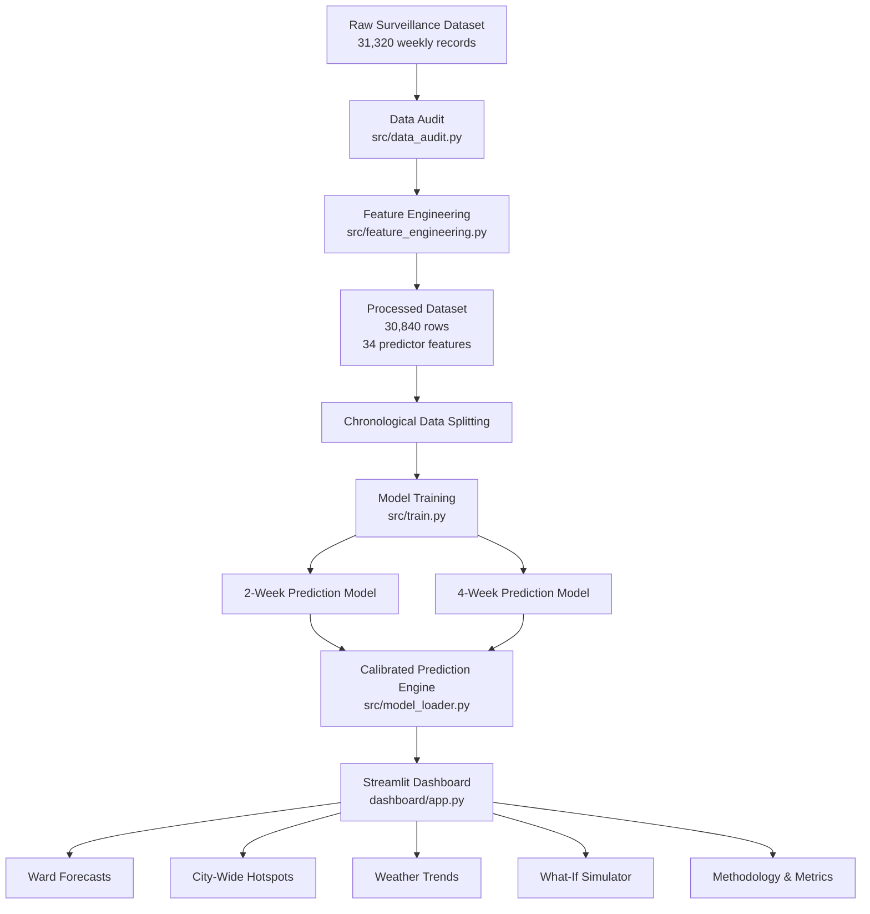

# DenguAlert AI — Urban Dengue Early-Warning System (Bangladesh)

[](https://www.python.org/)
[](https://streamlit.io/)
[](https://scikit-learn.org/)

> **Hackathon Qualifier Phase 1 Entry**
> DenguAlert AI is a data-driven, ward-level dengue early-warning and decision-support system designed for urban areas in Bangladesh. It provides separate 14-day (2-week) and 28-day (4-week) dengue case forecasts using historical surveillance and meteorological data.

**Live Application:** https://humanaali-dengueguard-ai-dashboardapp-ztb3md.streamlit.app/
**GitHub Repository:** https://github.com/HumanaAli/DengueGuard-AI

---

## 📌 Executive Summary

Dengue transmission in urban Bangladesh is influenced by environmental conditions, particularly rainfall, temperature, humidity, and mosquito breeding patterns. Rainfall can create breeding habitats for *Aedes aegypti*, while changes in temperature and humidity influence mosquito development and transmission dynamics.

Traditional reactive vector-control approaches may respond only after dengue cases increase. DenguAlert AI aims to support earlier public-health intervention through ward-level forecasting and risk monitoring.

The system provides:

1. **Multi-Horizon Prediction:** Separate 2-week (`target_2w`) and 4-week (`target_4w`) dengue case forecasts.
2. **Calibrated Risk Classification:** Four operational risk categories: Low, Medium, High, and Critical.
3. **Historical Weather Analysis:** Rainfall, temperature, humidity, lag features, and rolling weather aggregates.
4. **Ward-Level Monitoring:** Ward early-warning forecasts and city-wide hotspot prioritization.
5. **Interactive Decision Support:** A Streamlit dashboard with five modules, including historical trends and a what-if weather scenario simulator.
6. **Leakage Prevention:** Chronological train, validation, and test partitions, with model inputs excluding current and future target information.

The system is a public-health decision-support prototype, not a clinical diagnostic system or a replacement for official surveillance.

---

## ⚡ Quick Local Setup

### 1. Prerequisites

- Python 3.14.0
- Git
- Internet connection for initial dependency installation

Python 3.14.0 has been tested locally, and the deployed application uses Python 3.14 on Streamlit Community Cloud.

### 2. Clone the repository

```bash
git clone https://github.com/HumanaAli/DengueGuard-AI.git
cd DengueGuard-AI
```

### 3. Create a virtual environment

```bash
python -m venv .venv
```

Activate it according to your operating system.

**Windows PowerShell:**

```powershell
.\.venv\Scripts\Activate.ps1
```

**Windows Command Prompt:**

```cmd
.venv\Scripts\activate.bat
```

**Linux/macOS:**

```bash
source .venv/bin/activate
```

### 4. Install dependencies

```bash
python -m pip install -r requirements.txt
```

### 5. Launch the dashboard

```bash
streamlit run dashboard/app.py
```

Open your browser at:

```text
http://localhost:8501
```

### Tested Core Package Versions

| Package | Tested version |
|---|---:|
| Python | 3.14.0 |
| Streamlit | 1.67.0 |
| Plotly | 7.1.0 |
| Scikit-learn | 1.9.1 |
| Pandas | 3.1.1 |
| NumPy | 2.5.5 |
| Joblib | 1.6.0 |
| Openpyxl | 3.1.5 |

Package version ranges are defined in `requirements.txt`.

---

## 🏗️ System Architecture & Workflow

The complete architecture, data-flow diagram, chronological validation strategy, model-selection rationale, inference process, and cost-control design are documented separately.

**Architecture documentation:** [ARCHITECTURE.md](ARCHITECTURE.md)

### High-Level Data Flow



### Data and Feature Engineering

The project uses the supplied Excel workbook:

`data/hackathon_preli_dataset.xlsx`

The dataset contains:

- 31,320 weekly records.
- 60 monitored wards.
- 5 cities.
- Historical dengue and meteorological observations.

The feature engineering pipeline in `src/feature_engineering.py` generates 34 predictor features, including:

- Rainfall lags (1–4 weeks).
- Two-week cumulative rainfall.
- Four-week cumulative rainfall.
- Log-transformed rainfall.
- Temperature lag features.
- Four-week average temperature.
- Humidity lag features.
- Temperature–humidity interaction.
- Historical dengue case lags.
- Ward vulnerability indicators.
- Calendar and monsoon-related features.

Lag and rolling calculations are grouped by ward to prevent values from one ward from being incorrectly used for another.

The processed dataset is stored at:

`data/processed/model_dataset.csv`

---

## 📊 Benchmark Test Performance

**Evaluation partition:** Untouched chronological 2025 test split
**Test sample size:** 3,120 records

| Metric | 2-Week Model (14-Day Lead) | 4-Week Model (28-Day Lead) |
|---|---:|---:|
| **Continuous MAE** | **1.0549 cases** | **1.1904 cases** |
| **Continuous RMSE** | **2.1256 cases** | **2.3158 cases** |
| **Poisson Deviance** | **0.8576** | **1.0087** |
| **Critical Outbreak Recall** | **72.2% (182 / 252 caught)** | **65.1% (164 / 252 caught)** |
| **Critical Precision** | **47.3%** | **38.7%** |
| **Low-Risk Specificity** | **97.1%** | **94.7%** |
| **Macro F1-Score** | **0.6183** | **0.5856** |

These are retrospective benchmark results on the supplied dataset. They represent historical evaluation performance and do not guarantee future outbreak detection.

See `docs/MODEL_EVALUATION.md` and `docs/MODEL_IMPROVEMENT.md` for additional evaluation details.

---

## 🎯 Calibrated Risk Tiers & Public Health Directives

The operational prediction engine uses calibrated decision thresholds to translate continuous predicted case counts into four risk categories.

### Risk Classification

| Risk Tier | 2-Week Threshold | 4-Week Threshold | Suggested Operational Response |
|---|---:|---:|---|
| 🟢 **Low** | `< 0.8` | `< 0.8` | Routine surveillance and public hygiene awareness. |
| 🟡 **Medium** | `0.8 ≤ prediction < 4.0` | `0.8 ≤ prediction < 4.0` | Source reduction, drain clearance, and targeted larvicide application. |
| 🟠 **High** | `4.0 ≤ prediction < 8.0` | `4.0 ≤ prediction < 8.5` | Consider targeted vector-control deployment, public alerts, and preparation of diagnostic resources. |
| 🔴 **Critical** | `≥ 8.0` | `≥ 8.5` | Prioritize emergency public-health assessment, hospital preparedness, and coordinated vector-control response. |

The underlying benchmark ground-truth categories are:

- Low: fewer than 1 case.
- Medium: 1 to fewer than 4 cases.
- High: 4 to fewer than 10 cases.
- Critical: 10 or more cases.

The calibrated operational thresholds account for regression peak smoothing and are stored in:

`models/calibrated_config.json`

These suggested actions are decision-support guidance, not official medical or government-issued protocols.

---

## 🔒 Verification & Anti-Leakage Governance

### Chronological Validation

The project uses chronological partitions rather than random train/test splitting.

| Partition | Period | Records | Purpose |
|---|---|---:|---|
| Training | Through 2023 | 24,540 | Model fitting |
| Validation | 2024 | 3,180 | Model selection and threshold calibration |
| Testing | 2025 | 3,120 | Final held-out evaluation |

The partitioning process uses the future outcome date (`target_date_4w`) to preserve chronological separation.

### Leakage Prevention

The inference engine explicitly excludes:

- `dengue_cases`
- `target_2w`
- `target_4w`
- `target_date_2w`
- `target_date_4w`
- `date`
- `split`

Historical observations and appropriately lagged meteorological variables are used for prediction.

### Model Checksums (SHA-256)

The production models have corresponding checksum records:

- `models/model_2w.joblib`
  `3646673bf04b6002739edfebf619beacfb7bd2b3678026640d1e991df112f8c7`

- `models/model_4w.joblib`
  `fb889d62470594ae70602ad9b7b609079d6ee1acad3ba3eb52e5498cdcd3c4fb`

Byte-identical model backups are maintained in `models/backups/`.

---

## 💻 Interactive Dashboard Modules

The Streamlit dashboard provides five modules:

### 1. Ward Early-Warning & Forecast

Provides ward-level dengue forecasts for 2-week and 4-week horizons, including predicted cases, risk classification, and associated risk information.

### 2. City-Wide Hotspot Ranking

Ranks monitored wards according to predicted dengue risk to support prioritization of high-risk areas.

### 3. Temporal Trends & Weather Dynamics

Visualizes historical dengue trends alongside rainfall, temperature, and humidity patterns.

### 4. What-If Weather Simulator

Allows users to explore hypothetical weather scenarios using selected historical ward observations.

This module is a scenario/sensitivity analysis tool, not a live weather forecast. Its current implementation changes selected current-week weather inputs and the derived current-rainfall log value; it does not reconstruct an entire multi-week simulated weather history.

### 5. System Methodology & Metrics

Provides information about the prediction methodology, model evaluation, risk thresholds, and project performance.

---

## 💰 Compute Efficiency & API Cost Controls

The application is designed to run its core prediction workflow using locally stored data and machine-learning models.

### Model Caching

The dashboard uses:

- `st.cache_resource` to cache the loaded prediction engine and model resources.
- `st.cache_data` to cache the processed surveillance dataset.

This avoids repeatedly loading the same models and data during normal Streamlit reruns.

### Local Model Inference

The production models are loaded from:

- `models/model_2w.joblib`
- `models/model_4w.joblib`

The `PredictionEngine` in `src/model_loader.py` performs the core prediction and risk-classification workflow locally within the application process.

### External API Usage

The current application does not use a paid weather API, LLM API, or remote prediction endpoint for its core forecasting functionality.

The dashboard uses the supplied historical dataset rather than retrieving live meteorological observations.

A decorative static image is loaded from the Flaticon CDN. This is a static asset request, not a weather-data or machine-learning inference API.

No external API key is required for the current application.

---

## 🧪 Reproducibility & Automated Tests

### Run Integration Tests

From the project root, with the virtual environment activated:

```bash
python -m unittest tests/test_dashboard_integration.py
```

### Run Independent Verification

```bash
python src/independent_verification.py
```

### Run Data Audit

```bash
python src/data_audit.py
```

### Rebuild Engineered Features

```bash
python src/feature_engineering.py
```

### Train Models

```bash
python src/train.py
```

Note: Training and feature-rebuilding commands regenerate project artifacts. The deployed dashboard uses the existing processed dataset and saved production models, so these commands are not required for ordinary application launch.

---

## 📁 Repository Directory Structure

```text
DengueGuard-AI/
│
├── ARCHITECTURE.md
├── README.md
├── requirements.txt
├── .gitignore
├── inspect_dataset.py
│
├── dashboard/
│   └── app.py
│
├── data/
│   ├── hackathon_preli_dataset.xlsx
│   └── processed/
│       └── model_dataset.csv
│
├── docs/
│   ├── DATA_AUDIT.md
│   ├── FEATURE_ENGINEERING.md
│   ├── MODEL_EVALUATION.md
│   ├── MODEL_IMPROVEMENT.md
│   ├── PROJECT_TECHNICAL_DOCUMENTATION.md
│   ├── FINAL_VERIFICATION_REPORT.md
│   └── DASHBOARD_GUIDE.md
│
├── models/
│   ├── model_2w.joblib
│   ├── model_4w.joblib
│   ├── calibrated_config.json
│   ├── backups/
│   └── experiments/
│
├── src/
│   ├── data_audit.py
│   ├── feature_engineering.py
│   ├── train.py
│   ├── optimize_models.py
│   ├── audit_pipeline.py
│   ├── independent_verification.py
│   └── model_loader.py
│
└── tests/
    └── test_dashboard_integration.py
```

---

## 🤖 AI Assistance, API Disclosure & Contributions

### AI-Assisted Development Disclosure

OpenAI ChatGPT was used as an AI-assisted development tool for:

- Debugging support and interpretation of error messages.
- Code review suggestions and troubleshooting.
- Documentation drafting and refinement.
- Python environment and deployment guidance.
- Identification of compatibility issues during testing.

AI-generated suggestions were reviewed and tested during development. The project team is responsible for the final implementation, testing, and submitted results.

### External API Disclosure

The current forecasting implementation does not depend on paid external weather APIs, LLM APIs, or remote machine-learning inference services.

Core prediction is performed locally using the project's saved scikit-learn models and historical dataset.

The application is hosted through Streamlit Community Cloud, and the source code is maintained in GitHub. The dashboard also loads a decorative static image from the Flaticon CDN.

### Team Contributions

Individual contributions should be represented by genuine Git commits under the respective contributors' GitHub identities.

The repository's Git history serves as the record of development and collaboration. Commit authorship and dates should reflect actual contributions.

---

## ⚠️ Limitations & Intended Use

DenguAlert AI is a hackathon-stage public-health decision-support prototype.

- Predictions are based on the supplied historical surveillance dataset.
- Historical model evaluation does not guarantee future prediction accuracy.
- The dashboard does not currently retrieve live weather observations.
- The what-if simulator explores selected historical weather scenarios and is not a full multi-week weather forecasting engine.
- Risk categories and suggested interventions should be reviewed by relevant public-health professionals before operational use.

The project is intended to demonstrate the potential of data-driven ward-level dengue early-warning systems and should complement, not replace, official public-health surveillance and expert judgment.

---

## 🌐 Live Deployment

**Application:**
https://humanaali-dengueguard-ai-dashboardapp-ztb3md.streamlit.app/

**GitHub Repository:**
https://github.com/HumanaAli/DengueGuard-AI

The dashboard is deployed using Streamlit Community Cloud, with `dashboard/app.py` as its application entry point.
