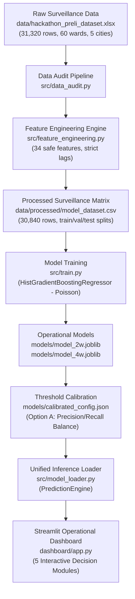

# DenguAlert AI — Urban Dengue Early-Warning System (Bangladesh)

[](https://www.python.org/)
[](https://streamlit.io/)
[](https://scikit-learn.org/)
[](https://opensource.org/licenses/MIT)

> **Hackathon Qualifier Phase 1 Entry**  
> An enterprise-grade, data-driven early-warning system designed for municipal city corporations in Bangladesh to forecast ward-level dengue outbreak risks with **14-day (2-Week)** and **28-day (4-Week)** lead times.

---

## 📌 Executive Summary

Dengue virus transmission in urban Bangladesh is characterized by severe non-linear lags: rainfall creates breeding pools for *Aedes aegypti* mosquitoes, which take 7–14 days to emerge as adults, followed by 5–10 days of extrinsic viral incubation before human infections appear in clinical surveillance. Traditional reactive vector control is deployed too late, after hospitals are already overwhelmed.

**DenguAlert AI** solves this critical public health bottleneck by:
1. **Providing True Predictive Lead Time:** Multi-horizon forecasts 2 weeks (`target_2w`) and 4 weeks (`target_4w`) ahead.
2. **Preventing Peak Underestimation:** Calibrated decision thresholds on Poisson gradient boosted regressors achieving **72.2% Critical Outbreak Recall** at 2 weeks and **65.1%** at 4 weeks on untouched 2025 test data.
3. **Ensuring Flawless Data Governance:** Strict chronological dataset splitting, complete absence of future target leakage, and byte-identical SHA-256 model backups.
4. **Delivering an Interactive Operational Dashboard:** An intuitive Streamlit platform featuring micro-level ward early warning, city-wide hotspot triage, temporal trend analysis, and a what-if weather simulator.

---

## ⚡ Fast Local Setup (Under 3 Minutes)

### 1. Prerequisites
- Python 3.10, 3.11, or 3.12
- Git

### 2. Installation
```bash
# Clone repository
git clone https://github.com/your-repo/Dengu_Alert.git
cd Dengu_Alert

# Create and activate virtual environment
python -m venv .venv
# On Windows:
.venv\Scripts\activate
# On Linux/macOS:
source .venv/bin/activate

# Install required dependencies
pip install -r requirements.txt
```

### 3. Launch Operational Dashboard
```bash
streamlit run dashboard/app.py
```
Open your browser at `http://localhost:8501`.

---

## 🏗️ System Architecture & Workflow



---

## 📊 Benchmark Test Performance (Untouched 2025 Test Split, N = 3,120)

| Metric | 2-Week Forward Model (14-Day Lead) | 4-Week Forward Model (28-Day Lead) |
| :--- | :---: | :---: |
| **Continuous MAE** | **1.0549 cases** | **1.1904 cases** |
| **Continuous RMSE** | **2.1256 cases** | **2.3158 cases** |
| **Poisson Deviance** | **0.8576** | **1.0087** |
| **Critical Outbreak Recall** | **72.2% (182 / 252 caught)** | **65.1% (164 / 252 caught)** |
| **Critical Precision** | **47.3%** | **38.7%** |
| **Low-Risk Specificity** | **97.1%** | **94.7%** |
| **Macro F1-Score** | **0.6183** | **0.5856** |

---

## 🎯 Calibrated Risk Tiers & Public Health Directives

Actual ground truth definition: Low ($<1$), Medium ($1-4$), High ($4-10$), Critical ($\ge 10$ cases).  
Calibrated operational decision thresholds account for regression peak smoothing:

| Risk Tier | 2W Threshold | 4W Threshold | Standard Operating Procedure (SOP) |
| :--- | :---: | :---: | :--- |
| 🟢 **Low** | $< 0.8$ | $< 0.8$ | Baseline surveillance; maintain public hygiene awareness. |
| 🟡 **Medium** | $0.8 \le \hat{y} < 4.0$ | $0.8 \le \hat{y} < 4.0$ | Source reduction; clear blocked drains; targeted larvicide application. |
| 🟠 **High** | $4.0 \le \hat{y} < 8.0$ | $4.0 \le \hat{y} < 8.5$ | Vector fogging deployment; public SMS alerts; preposition rapid antigen kits. |
| 🔴 **Critical** | $\ge 8.0$ | $\ge 8.5$ | **Emergency Epidemic Response:** Emergency operations center activation; hospital surge wards. |

---

## 🔒 Verification & Anti-Leakage Governance

- **Zero Future Leakage:** Models strictly exclude contemporaneous `dengue_cases`, future targets, target dates, and split labels. Only historical lags ($t-1, t-2, \dots$) and weekly meteorological aggregates available at observation close are ingested.
- **Model Checksums (SHA-256):**
  - `models/model_2w.joblib`: `3646673bf04b6002739edfebf619beacfb7bd2b3678026640d1e991df112f8c7`
  - `models/model_4w.joblib`: `fb889d62470594ae70602ad9b7b609079d6ee1acad3ba3eb52e5498cdcd3c4fb`
  - Byte-identical backups verified in `models/backups/`.

---

## 📁 Repository Directory Structure

```
Dengu_Alert/
├── dashboard/
│   └── app.py                     # Streamlit Operational Early-Warning Dashboard
├── data/
│   ├── hackathon_preli_dataset.xlsx  # Raw dataset (31,320 rows, 60 wards)
│   └── processed/
│       └── model_dataset.csv      # Engineered ML dataset (30,840 rows, 34 features)
├── docs/
│   ├── DATA_AUDIT.md              # Stage 1: Data quality audit
│   ├── FEATURE_ENGINEERING.md     # Stage 2: Feature pipeline & leakage proofs
│   ├── MODEL_EVALUATION.md        # Stage 3: Baseline model evaluation
│   ├── MODEL_IMPROVEMENT.md       # Stage 3.1: Optimization & calibration
│   ├── PROJECT_TECHNICAL_DOCUMENTATION.md # Comprehensive technical audit
│   ├── FINAL_VERIFICATION_REPORT.md      # Independent verification report
│   └── DASHBOARD_GUIDE.md         # Operational dashboard documentation
├── models/
│   ├── model_2w.joblib            # Production 2-week prediction model
│   ├── model_4w.joblib            # Production 4-week prediction model
│   ├── calibrated_config.json     # Adopted operational threshold config
│   ├── backups/                   # SHA-256 verified byte-identical backups
│   └── experiments/               # Option B weighted comparison models
├── src/
│   ├── data_audit.py              # Audit script
│   ├── feature_engineering.py     # Feature engineering script
│   ├── train.py                   # Model training script
│   ├── optimize_models.py         # Optimization & calibration script
│   ├── audit_pipeline.py          # Pipeline audit suite
│   ├── independent_verification.py# Independent verification script
│   └── model_loader.py            # Unified prediction engine
├── tests/
│   └── test_dashboard_integration.py # Integration test suite
├── requirements.txt               # Pinned package requirements
└── README.md                      # Project documentation
```

---

## 🧪 Running Verification & Tests

To execute the automated unit and integration test suite:
```bash
python -m unittest tests/test_dashboard_integration.py
```
To run the full independent data and model verification audit:
```bash
python src/independent_verification.py
```
