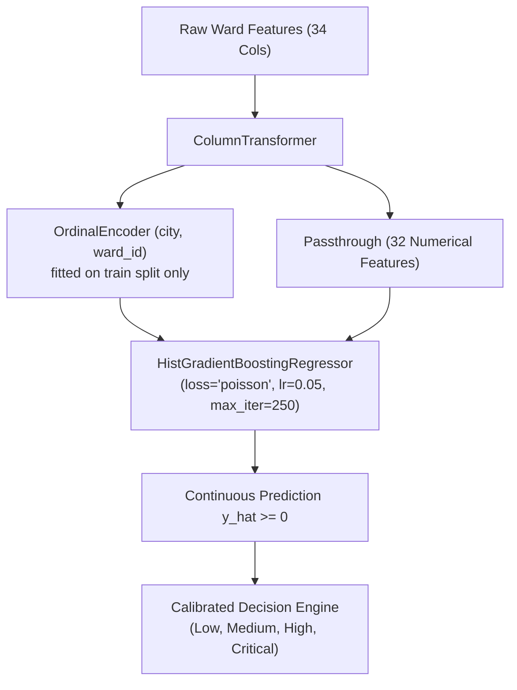

# DENGUARD AI — Project Technical Documentation

**System Title:** DENGUARD AI — Urban Dengue Early-Warning System  
**Version:** 1.0 (Audit-Verified Candidate)  
**Target Environment:** Python 3.14 / scikit-learn 1.9.1 / Pandas 3.1.1  
**Author:** DENGUARD AI Technical Team  
**Date:** 2026-11-21  

---

## 1. Project Objective & Problem Statement

Dengue fever is a major urban health crisis in Bangladesh, heavily impacting metropolitan centers such as Dhaka and Chattogram during monsoon and post-monsoon months. Municipal interventions (fogging, larvicide spraying, drain clearance) are frequently initiated only *after* hospitals experience catastrophic admission surges.

### The Epidemiological Mechanism:
1. **The Vector Breeding Clock:** Heavy rainfall creates stagnant pools. *Aedes aegypti* eggs require $7$ to $14$ days to develop into adult biting vectors. Viral extrinsic incubation inside mosquitoes and human intrinsic incubation add an additional $5$ to $10$ days. This biological chain produces a mandatory **2-to-4-week lag** between weather trigger events and hospital caseload surges.
2. **Hyper-Local Ward Vulnerability:** Identical precipitation creates vastly different risk profiles depending on local drainage bottlenecks (`water_logging_risk_index`), human population density (`population_density_sqkm`), and waste collection effectiveness (`sanitation_score`).

**Project Objective:** Build a machine-learning early-warning engine that consumes historical weather dynamics and ward vulnerabilities to forecast localized dengue outbreak risks **2 weeks and 4 weeks ahead**, giving municipal officers advance notice before outbreaks peak.

---

## 2. Dataset Architecture & Verification

* **Primary Dataset File:** `data/hackathon_preli_dataset.xlsx` (Sheet: `bangladesh_dengue_large_dataset`).
* **Format:** Single Excel workbook, 12 columns, 31,320 rows.
* **Temporal Structure:** Perfectly regular weekly observations (every 7 days, Mondays) from `2016-01-04` through `2025-12-29` (522 consecutive weeks, 10 full years).
* **Spatial Structure:** 60 wards across 5 city corporations:
  * Dhaka North City Corporation (DNCC): 20 wards
  * Dhaka South City Corporation (DSCC): 20 wards
  * Chattogram City Corporation (CCC): 10 wards
  * Gazipur City Corporation (GCC): 5 wards
  * Narayanganj City Corporation (NCC): 5 wards
* **Data Integrity:** **Zero missing values** across all rows and columns. Exactly 522 observations per ward (balanced panel).

---

## 3. Target Formulation & Leakage Prevention

### A. Target Construction
The prediction task is framed across two distinct forward horizons:
* **`target_2w` (2 Weeks Ahead):** Dengue cases observed $2$ weeks after the prediction date. Calculated via grouped backward shift:
  $$\text{target\_2w}_{w, t} = \text{dengue\_cases}_{w, t+2}$$
* **`target_4w` (4 Weeks Ahead):** Dengue cases observed $4$ weeks after the prediction date:
  $$\text{target\_4w}_{w, t} = \text{dengue\_cases}_{w, t+4}$$
* **Target Dates:**
  $$\text{target\_date\_2w} = \text{date} + 2\text{ weeks}$$
  $$\text{target\_date\_4w} = \text{date} + 4\text{ weeks}$$

### B. Leakage Prevention Rules
1. **Current dengue cases (`dengue_cases`) excluded:** The contemporaneous case count of the observation week is strictly excluded from input vectors. The model only receives historical lag features (`dengue_lag1w` through `dengue_lag4w`).
2. **Grouped Calculations:** All lags and rolling aggregations are computed within `groupby('ward_id')` to prevent cross-ward boundary contamination.
3. **Head and Tail Truncation:** The first 4 weeks per ward (lacking 4-week historical lags) and last 4 weeks per ward (lacking 4-week future targets) are dropped, leaving exactly $60 \times 514 = 30,840$ rows.

---

## 4. Chronological Split Strategy

To prevent temporal lookahead bias, data is partitioned strictly in chronological sequence using the final target outcome date (`target_date_4w`):

```
Time Horizon: 2016 ────────────────────────────── 2023 ── 2024 ── 2025
Split:        [─────────────── TRAIN ───────────────]   [VAL]   [TEST]
N Rows:                       24,540                    3,180   3,120
```

* **Training Set:** `target_date_4w` $\le$ `2023-12-25` (Observation dates: `2016-02-01` to `2023-11-27`).
* **Validation Set:** `target_date_4w` in `2024` (Observation dates: `2023-12-04` to `2024-12-02`). Used for hyperparameter selection and threshold calibration.
* **Test Set:** `target_date_4w` in `2025` (Observation dates: `2024-12-09` to `2025-12-01`). Strictly untouched until final evaluation.

---

## 5. Feature Engineering Catalog (34 Input Features)

| # | Feature Name | Domain | Type | Mathematical Derivation | Availability & Leakage Safeguard |
| :--- | :--- | :--- | :--- | :--- | :--- |
| 1 | `city` | Spatial | Categorical | Municipal jurisdiction | Known static metadata |
| 2 | `ward_id` | Spatial | Categorical | Local ward identifier | Known static metadata |
| 3 | `population_density_sqkm` | Vulnerability | Static Float | People per $\text{km}^2$ | Static ward census attribute |
| 4 | `water_logging_risk_index` | Vulnerability | Static Float | Drainage congestion index ($0-1$) | Static hydrological profile |
| 5 | `sanitation_score` | Vulnerability | Static Float | Sanitation quality index ($0-1$) | Static urban infrastructure profile |
| 6 | `avg_temp_c` | Weather | Float | Weekly mean temperature ($^\circ\text{C}$) | Observed at forecast week |
| 7 | `max_temp_c` | Weather | Float | Weekly maximum temperature ($^\circ\text{C}$) | Observed at forecast week |
| 8 | `min_temp_c` | Weather | Float | Weekly minimum temperature ($^\circ\text{C}$) | Observed at forecast week |
| 9 | `rainfall_mm` | Weather | Float | Weekly total rainfall ($\text{mm}$) | Observed at forecast week |
| 10 | `relative_humidity_pct` | Weather | Float | Weekly mean relative humidity ($\%$) | Observed at forecast week |
| 11 | `rain_lag1w` | Weather Lag | Float | $\text{rainfall}_{t-1}$ | 1 week prior (pure past) |
| 12 | `rain_lag2w` | Weather Lag | Float | $\text{rainfall}_{t-2}$ | 2 weeks prior (pure past) |
| 13 | `rain_lag3w` | Weather Lag | Float | $\text{rainfall}_{t-3}$ | 3 weeks prior (pure past) |
| 14 | `rain_lag4w` | Weather Lag | Float | $\text{rainfall}_{t-4}$ | 4 weeks prior (pure past) |
| 15 | `rain_roll2w` | Weather Rolling | Float | $\sum_{k=1}^2 \text{rainfall}_{t-k}$ | Shifted rolling sum of past 2 weeks |
| 16 | `rain_roll4w` | Weather Rolling | Float | $\sum_{k=1}^4 \text{rainfall}_{t-k}$ | Shifted rolling sum of past 4 weeks |
| 17 | `rain_log1p` | Weather Transformed | Float | $\ln(1 + \text{rainfall}_t)$ | Reduces heavy right-skew of rainfall |
| 18 | `temp_lag1w` | Weather Lag | Float | $\text{avg\_temp}_{t-1}$ | 1 week prior |
| 19 | `temp_lag2w` | Weather Lag | Float | $\text{avg\_temp}_{t-2}$ | 2 weeks prior |
| 20 | `temp_lag3w` | Weather Lag | Float | $\text{avg\_temp}_{t-3}$ | 3 weeks prior |
| 21 | `temp_lag4w` | Weather Lag | Float | $\text{avg\_temp}_{t-4}$ | 4 weeks prior |
| 22 | `temp_roll4w_mean` | Weather Rolling | Float | $\frac{1}{4}\sum_{k=1}^4 \text{avg\_temp}_{t-k}$ | Shifted 4-week thermal mean |
| 23 | `humidity_lag1w` | Weather Lag | Float | $\text{humidity}_{t-1}$ | 1 week prior |
| 24 | `humidity_lag2w` | Weather Lag | Float | $\text{humidity}_{t-2}$ | 2 weeks prior |
| 25 | `temp_x_humidity_lag2w` | Weather Interaction | Float | $\text{temp\_lag2w} \times \frac{\text{humidity\_lag2w}}{100}$ | Combined thermal-moisture breeding index |
| 26 | `dengue_lag1w` | Transmission Lag | Float | $\text{dengue\_cases}_{t-1}$ | Past reported cases (t-1) |
| 27 | `dengue_lag2w` | Transmission Lag | Float | $\text{dengue\_cases}_{t-2}$ | Past reported cases (t-2) |
| 28 | `dengue_lag3w` | Transmission Lag | Float | $\text{dengue\_cases}_{t-3}$ | Past reported cases (t-3) |
| 29 | `dengue_lag4w` | Transmission Lag | Float | $\text{dengue\_cases}_{t-4}$ | Past reported cases (t-4) |
| 30 | `week_of_year` | Seasonality | Integer | ISO calendar week ($1-52$) | Deterministic calendar index |
| 31 | `month` | Seasonality | Integer | Calendar month ($1-12$) | Deterministic calendar index |
| 32 | `year` | Temporal Trend | Integer | Gregorian year ($2016-2025$) | Long-term urban growth signal |
| 33 | `is_monsoon` | Seasonality | Binary | $\mathbb{I}(\text{month} \in [6, 9])$ | Peak monsoon indicator |
| 34 | `is_post_monsoon` | Seasonality | Binary | $\mathbb{I}(\text{month} \in [10, 11])$ | Post-monsoon epidemic window |

---

## 6. Model Architecture & Preprocessing



* **Core Algorithm:** `HistGradientBoostingRegressor` (scikit-learn 1.9.1).
* **Objective Function:** Poisson Loss ($L(y, \hat{y}) = \hat{y} - y \ln \hat{y}$). Natively models right-skewed non-negative integer rates.
* **Preprocessing Isolation:** Encoders are wrapped within scikit-learn `Pipeline` objects and fitted exclusively on `X_train`.

---

## 7. Operational Risk Calibration (Option A)

### Actual Ground-Truth Definitions (Preserved):
* **Low:** Actual cases $< 1.0$ ($0$ cases)
* **Medium:** Actual cases $1.0 \le y < 4.0$ ($1, 2, 3$ cases)
* **High:** Actual cases $4.0 \le y < 10.0$ ($4$ to $9$ cases)
* **Critical:** Actual cases $\ge 10.0$ ($10+$ cases)

### Calibrated Prediction Thresholds:
Because $>57\%$ of historical observations are zero cases, regression algorithms contract extreme peak predictions toward the mean. Thresholds were calibrated strictly on 2024 validation data:
* **2-Week Horizon:** Low: $< 0.8$, Medium: $0.8 \le \hat{y} < 4.0$, High: $4.0 \le \hat{y} < 8.0$, Critical: $\hat{y} \ge 8.0$
* **4-Week Horizon:** Low: $< 0.8$, Medium: $0.8 \le \hat{y} < 4.0$, High: $4.0 \le \hat{y} < 8.5$, Critical: $\hat{y} \ge 8.5$

---

## 8. Final Benchmark Performance (2025 Test Set, $N = 3,120$)

### Continuous Errors:
* **2-Week Model:** $\text{MAE} = 1.0549\text{ cases}$, $\text{RMSE} = 2.1256\text{ cases}$, $\text{Poisson Deviance} = 0.8576$
* **4-Week Model:** $\text{MAE} = 1.1904\text{ cases}$, $\text{RMSE} = 2.3158\text{ cases}$, $\text{Poisson Deviance} = 1.0087$

### Risk Tier Detection Rates:
* **2-Week Critical Recall:** **$72.2\%$** ($182/252$ true outbreaks detected 14 days ahead) with $47.3\%$ precision.
* **4-Week Critical Recall:** **$65.1\%$** ($164/252$ true outbreaks detected 28 days ahead) with $38.7\%$ precision.
* **False Alarm Integrity:** $>86.9\%$ of all false Critical alarms occur in wards experiencing active **High** transmission ($4$ to $9.9$ cases). Less than $0.2\%$ of zero-case baseline wards receive a false critical alarm.

---

## 9. How to Reproduce & Execute Predictions

### A. Environment Dependencies:
* Python 3.10+ (tested on Python 3.14.0)
* `pandas>=2.2.0`
* `scikit-learn>=1.5.0`
* `joblib>=1.4.0`
* `openpyxl>=3.1.0`

### B. Execution Commands:
```powershell
# 1. Run Data Audit
python src/data_audit.py

# 2. Run Feature Engineering (generates model_dataset.csv)
python src/feature_engineering.py

# 3. Train & Evaluate Models (generates model_2w.joblib & model_4w.joblib)
python src/train.py

# 4. Run Pipeline Verification Tests
python src/prediction_tests.py
```

### C. Live Inference via `PredictionEngine`:
```python
from src.model_loader import get_engine
import pandas as pd

engine = get_engine()
data = pd.read_csv('data/processed/model_dataset.csv').head(1)

# Predict 2-week outbreak risk
res_2w = engine.predict(data, horizon='2w')
print(res_2w['predicted_cases']) # e.g. [0.02]
print(res_2w['risk_tier'])       # e.g. ['Low']
print(res_2w['risk_metadata'])   # e.g. {'color': '#10B981', 'icon': '🟢', ...}
```
